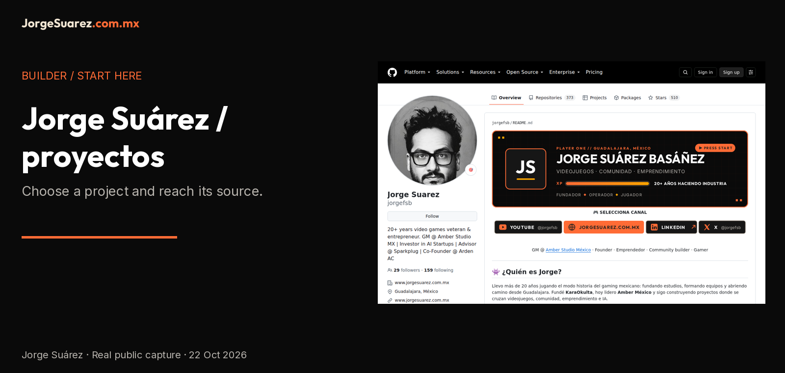
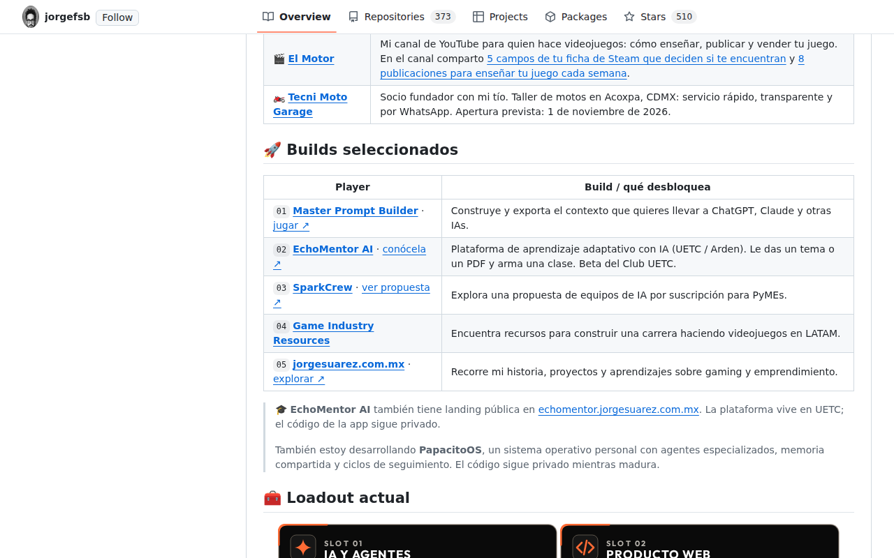

[Español](README.md) | [English](README.en.md)

<picture><source media="(max-width: 600px)" srcset="docs/media/cover-en-mobile.png"></picture>

# Jorge Suárez · projects to explore

**Start with a project, not a tool installation.** [Open Master Prompt Builder](https://github.com/jorgefsb/master-prompt-builder/blob/main/README.md) to prepare AI context, or [Game Industry Resources](https://github.com/jorgefsb/game-industry-resources/blob/main/README.md) to explore game industry resources.

## What is it?
This profile is a **builder's index** of Jorge Suárez's projects and links. It is not an application, an agent service or a platform with its own accounts.

## Who is it for?
People who want to discover projects, explore game industry resources or find the right repository before asking for technical help.

## Why does it exist?
To provide a clear entry point into public work and distinguish tools, proposals and references. The previous README describes the intersection of games, community, entrepreneurship and AI; this guide turns that into entry paths without inventing outcomes.

## How do I use it?
Choose a path and open its **main** README, the project's published reference. This family's new documentation is a local proposal: these links do not imply it has already been merged.

| I want to… | Open | Scope |
|---|---|---|
| Prepare context for AI | [Master Prompt Builder](https://github.com/jorgefsb/master-prompt-builder/blob/main/README.md) | Context building and export tool. |
| Explore game industry resources | [Game Industry Resources](https://github.com/jorgefsb/game-industry-resources/blob/main/README.md) | Resource directory. |
| Visit the personal site | [jorgesuarez.com.mx](https://github.com/jorgefsb/jorgesuarez.com.mx/blob/main/README.md) · [site](https://jorgesuarez.com.mx/) | Public story, projects and links. |
| Discover a learning proposal | [EchoMentor AI](https://github.com/jorgefsb/echomentor-ai) · [landing](https://echomentor.jorgesuarez.com.mx/) | A public landing does not demonstrate the private app; UETC / Arden retain their identity. |
| Explore a small-business proposal | [SparkCrew](https://github.com/jorgefsb/sparkcrew-landing) | Proposal presentation, not evidence of a purchased service. |

### Companies and the reference library are separate
Amber, Sparkplug, Arden / UETC and Tecni Moto retain their own brands. This personal signature does not replace them or turn their products into personal software. The previous profile mentions them; no clients, new roles, figures or business promises are added here.

Repositories labeled **Fork** on GitHub are third-party references: check the original repository and license. They are not presented as original work. Historical counts from the previous profile are not current metrics.

## When should or shouldn't I use it?
Use it to choose a project and reach its source. It does not automatically purchase services, manage accounts, run agents or verify a private app's availability.

## Where can I find it?
[Public profile](https://github.com/jorgefsb) · [Personal site](https://jorgesuarez.com.mx/) · [Official brandkit](https://brandkit.jorgesuarez.com.mx/).

## Before continuing
- **Availability:** public index; real capture from 22 October 2026. Not an installable release.
- **Requirements and technical help:** a browser for reading; linked tools have their own requirements. Library integration may need a developer or agent.
- **Cost and licensing:** reading this index requires no payment; external services may charge. This repository does not declare an open license for reusing all its content. Brand artwork is not MIT.
- **Privacy:** this README has no form of its own; GitHub and external destinations have their own policies. Never post passwords or customer data in issues.
- **Limitations:** links do not guarantee that products or betas are open. The recording shows the previously published profile, not this proposal already published.
- **Help:** [Jorge's public email](mailto:jorgefsb@gmail.com); tool-specific problems belong in that tool's repository.

## Look before deciding

Capture of the published profile, not an application mockup. [Video and English captions](docs/WALKTHROUGH.en.md) · [Subtítulos ES](docs/WALKTHROUGH.md).

## For documentation maintainers
[Documentation guide](docs/REPOSITORY-DOCUMENTATION.en.md) · [Media notice](docs/ASSET-NOTICE.en.md). No clone is needed to explore the index. Technical evidence is in `reports/docs-brandkit-verification.json`.
