<a href="https://jorgesuarez.com.mx">
  <picture>
    <source media="(max-width: 600px)" srcset="./assets/es/hero-mobile.svg" />
    
  </picture>
</a>

 

 

 

GM @ [Amber Studio México](https://amberstudio.com/location-guadalajara) · Founder · Emprendedor · Community builder · Gamer

---

## 👾 ¿Quién es Jorge?

Llevo más de 20 años jugando el modo historia del gaming mexicano: fundando estudios, formando equipos y abriendo camino desde Guadalajara. Fundé **KaraOkulta**, hoy lidero **Amber Studio México** y sigo construyendo donde se cruzan videojuegos, negocios e IA.

Mi misión principal no ha cambiado: **ayudar a que más gente pueda vivir de hacer videojuegos**. Si estás construyendo algo interesante, bienvenida la partida co-op.

## 🎯 Mis tres fuertes

Los dos primeros me tomaron décadas. La IA es mi New Game+ y la estoy subiendo de nivel en público.

## 🤖 Cómo construyo con IA

Vengo de operar estudios y empresas. Hoy saco software dirigiendo agentes de IA: yo escribo la especificación, Claude Code, Codex y Cursor escriben el código, y los cambios salen con respaldo, plan de rollback y postmortem. Casi todo lo que ves abajo se hizo así.

Detrás corre **PapacitoOS**, mi sistema operativo personal: agentes especializados, memoria compartida y ciclos de seguimiento. El código sigue privado mientras madura y tiene [página pública](https://os.jorgesuarez.com.mx).

## 🚀 Builds seleccionados

**🎮 Videojuegos**

| Build | Qué desbloquea |
|---|---|
| **[Game Industry Resources](https://github.com/jorgefsb/game-industry-resources)** · [abrir ↗](https://gamedev.jorgesuarez.com.mx) | Recursos para construir una carrera haciendo videojuegos en LATAM. |
| **[Game Feel](https://github.com/jorgefsb/game-feel)** | Metodología y adaptadores por marca para que un sitio responda como responde un juego. |
| **[Cursor líquido](https://github.com/jorgefsb/cursor-liquido)** | Efecto de cursor gratuito e independiente, con intensidades. Se conecta con Game Feel. |
| **[Moki Pixel](https://github.com/jorgefsb/moki-pixel)** · [conoce a Moki ↗](https://moki.jorgesuarez.com.mx) | Moki en pixel art: kit abierto de animación con exportes para juegos, mascota web y de escritorio, wallpapers y videos. |

**💼 Negocios**

| Build | Qué desbloquea |
|---|---|
| **[jorgesuarez.com.mx](https://github.com/jorgefsb/jorgesuarez.com.mx)** · [explorar ↗](https://jorgesuarez.com.mx) | Mi historia, proyectos y aprendizajes sobre gaming y emprendimiento. |
| **[SparkCrew](https://github.com/jorgefsb/sparkcrew-landing)** · [ver propuesta ↗](https://sparkcrew.jorgesuarez.com.mx) | Una propuesta de equipos de IA por suscripción para PyMEs. |

**🤖 IA**

| Build | Qué desbloquea |
|---|---|
| **[Master Prompt Builder](https://github.com/jorgefsb/master-prompt-builder)** · [jugar ↗](https://mpb.jorgesuarez.com.mx) | Construye y exporta el contexto que quieres llevar a ChatGPT, Claude y otras IAs. |
| **[EchoMentor AI](https://github.com/jorgefsb/echomentor-ai)** · [conócela ↗](https://echomentor.uetc.mx) | Aprendizaje adaptativo con IA (UETC / Arden). Le das un tema o un PDF y arma una clase. En beta en el Club UETC. El repo público es la landing; el código de la app sigue privado. |
| **[LinkedIn Automation Template](https://github.com/jorgefsb/linkedin-automation-template)** | Plantilla abierta que convierte una infografía en una tanda de posts de LinkedIn con flujos de IA. |

Sobre los forks: la mayoría de mis repositorios públicos son forks que conservo como biblioteca de referencia. Mi trabajo original es la lista de arriba.

## 🕹️ Misiones activas

| Slot | Misión actual |
|---|---|
| 🎮 **[Amber Studio México](https://amberstudio.com/location-guadalajara)** | General Manager del estudio de Guadalajara, parte de la red global de Amber. |
| 🏛️ **Arden AC** | Cofundador. Umbrella de [UETC](https://uetc.mx), [Brandcade](https://brandcade.com), [Logrus](https://logrus.jorgesuarez.com.mx) y [EGDC](https://club.uetc.mx). Desde UETC estamos construyendo **[EchoMentor AI](https://echomentor.uetc.mx)**. |
| 🎬 **[El Motor](https://www.youtube.com/@JorgeSuarezGM)** | Mi canal de YouTube para quien hace videojuegos: cómo enseñar, publicar y vender tu juego. Videos recientes: [5 campos de tu ficha de Steam que deciden si te encuentran](https://www.youtube.com/watch?v=P8B40c2887U) y [8 publicaciones para enseñar tu juego cada semana](https://www.youtube.com/watch?v=r_kzUvFT0EI). |
| 🤝 **Ecosistema** | Invierto en startups de IA, soy LP de [Altered Ventures](https://venturecapital.game) (el fondo de Mario Valle Reyes en IA, gaming y tecnología inmersiva), asesoro a [Sparkplug Technologies](https://getsparkplug.com) y colaboro con fundadores que quieren construir en grande. |
| 🏍️ **[Tecni Moto Garage](https://tecnimoto.mx)** | Socio fundador con mi tío. Taller de motos en Acoxpa, CDMX: servicio rápido, transparente y por WhatsApp. |

## 🧰 Loadout actual

## 🏆 Logros desbloqueados

---

<a href="mailto:jorgefsb@gmail.com">
  <picture>
    <source media="(max-width: 600px)" srcset="./assets/es/closing-mobile.svg" />
    
  </picture>
</a>

[jorgefsb@gmail.com](mailto:jorgefsb@gmail.com) · Guadalajara, Jalisco 🇲🇽 · [Read in English](https://github.com/jorgefsb)

Hecho con amor ❤️🎮 por <a href="https://jorgesuarez.com.mx">JorgeSuarez.com.mx</a> · perfil v3.0 · 10 nov 2026

