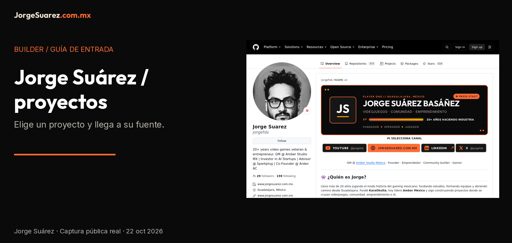

[Español](README.md) | [English](README.en.md)

<picture><source media="(max-width: 600px)" srcset="docs/media/cover-es-mobile.png"></picture>

# Jorge Suárez · proyectos para explorar

**Empieza por un proyecto, no por instalar herramientas.** [Abre Master Prompt Builder](https://github.com/jorgefsb/master-prompt-builder/blob/main/README.md) para preparar contexto para una IA, o [Game Industry Resources](https://github.com/jorgefsb/game-industry-resources/blob/main/README.md) para explorar recursos de videojuegos.

## ¿Qué es?
Este perfil es un **índice del builder**: reúne proyectos y enlaces de Jorge Suárez. No es una aplicación, un servicio de agentes ni una plataforma con cuenta propia.

## ¿Para quién?
Para quienes quieren conocer los proyectos, explorar recursos de videojuegos o encontrar el repositorio adecuado antes de pedir ayuda técnica.

## ¿Por qué existe?
Para encontrar una herramienta o recurso sin perderte entre repositorios. Aquí conviven proyectos de videojuegos, comunidad y construcción de herramientas con IA.

## ¿Cómo lo uso?
Elige una ruta y abre su README de **main**, que es la referencia publicada del proyecto. La nueva documentación de esta familia está en revisión: estos enlaces no aseguran que ya esté integrada.

| Quiero… | Abrir | Alcance |
|---|---|---|
| Preparar contexto para una IA | [Master Prompt Builder](https://github.com/jorgefsb/master-prompt-builder/blob/main/README.md) | Herramienta de construcción y exportación de contexto. |
| Explorar recursos de videojuegos | [Game Industry Resources](https://github.com/jorgefsb/game-industry-resources/blob/main/README.md) | Directorio de recursos. |
| Conocer el sitio personal | [jorgesuarez.com.mx](https://github.com/jorgefsb/jorgesuarez.com.mx/blob/main/README.md) · [sitio](https://jorgesuarez.com.mx/) | Historia, proyectos y enlaces públicos. |
| Conocer una propuesta de aprendizaje | [EchoMentor AI](https://github.com/jorgefsb/echomentor-ai) · [landing](https://echomentor.jorgesuarez.com.mx/) | La landing pública no demuestra la app privada; UETC / Arden conservan su identidad. |
| Explorar una propuesta para PyMEs | [SparkCrew](https://github.com/jorgefsb/sparkcrew-landing) | Presentación de una propuesta, no prueba de un servicio contratado. |

### Herramientas para páginas web

- [Cursor líquido](https://github.com/jorgefsb/cursor-liquido/blob/main/README.md): una estela de color junto al puntero; puedes probar la demo antes de integrarlo.
- [Papacito Juice](https://github.com/jorgefsb/papacito-juice/blob/main/README.md): movimiento y sonido de la marca personal, siempre con Moki.
- [Game Feel](https://github.com/jorgefsb/game-feel/blob/main/README.md): respuestas para una web con su propia identidad, sin exigir Moki.

Sus README explican requisitos y licencias. Ponerlas en otra página requiere integración técnica.

### Empresas y biblioteca: no confundir
Amber, Sparkplug, Arden / UETC y Tecni Moto conservan sus marcas. Esta firma personal no las sustituye ni convierte sus productos en software personal. El perfil anterior las menciona; aquí no se añaden clientes, cargos nuevos, cifras ni promesas comerciales.

Los repositorios marcados **Fork** en GitHub son referencias de terceros: revisa su repositorio original y licencia. No se presentan como autoría original. Los conteos históricos del perfil anterior no son métricas actuales.

## ¿Cuándo conviene y cuándo no?
Úsalo para elegir un proyecto y llegar a su fuente. No sirve para contratar automáticamente, administrar cuentas, ejecutar agentes ni verificar la disponibilidad de una app privada.

## ¿Dónde lo encuentro?
[Perfil público](https://github.com/jorgefsb) · [Sitio personal](https://jorgesuarez.com.mx/) · [Brandkit oficial](https://brandkit.jorgesuarez.com.mx/).

## Antes de seguir
- **Disponibilidad:** índice público; captura real del 22 de octubre de 2026. No es una versión instalable.
- **Requisitos y ayuda técnica:** navegador para leer; las herramientas enlazadas tienen sus propios requisitos. Integrar bibliotecas puede requerir developer o agente.
- **Costos y licencia:** leer este índice no exige pago; servicios externos pueden cobrar. Este repositorio no declara una licencia abierta para reutilizar todo su contenido. Las marcas no son MIT.
- **Privacidad:** no hay formulario propio en este README; GitHub y destinos externos tienen sus políticas. No publiques contraseñas ni datos de clientes en issues.
- **Límites:** enlaces no garantizan que productos o betas estén abiertos. La grabación muestra el perfil publicado anterior, no esta propuesta ya publicada.
- **Ayuda:** [correo público de Jorge](mailto:jorgefsb@gmail.com); problemas de una herramienta, en su propio repositorio.

## Ver antes de decidir

Captura del perfil publicado, no maqueta de una app. [Ver el video real](docs/media/walkthrough.mp4) · [Subtítulos y transcripción ES](docs/WALKTHROUGH.md) · [English captions](docs/WALKTHROUGH.en.md).

## Para quien mantiene la documentación
[Guía documental](docs/REPOSITORY-DOCUMENTATION.md) · [Aviso de medios](docs/ASSET-NOTICE.md). No se requiere clonar para explorar el índice. La evidencia técnica está en `reports/docs-brandkit-verification.json`.
