<a href="https://jorgesuarez.com.mx">
  <picture>
    <source media="(max-width: 600px)" srcset="./assets/en/hero-mobile.svg" />
    
  </picture>
</a>

 

 

 

GM @ [Amber Studio México](https://amberstudio.com/location-guadalajara) · Founder · Entrepreneur · Community builder · Gamer

---

## 👾 Who is Jorge?

I've spent more than 20 years playing the story mode of Mexican game development: founding studios, growing teams and opening doors from Guadalajara. I founded **KaraOkulta**, today I lead **Amber Studio México**, and I keep building where video games, business and AI meet.

My main mission hasn't changed: **help more people make a living making video games**. If you're building something interesting, the co-op slot is open.

## 🎯 My three strengths

The first two took me decades. AI is my New Game+ and I'm leveling it up in public.

## 🤖 How I build with AI

I come from running studios and companies. Today I ship software by directing AI agents: I write the spec, Claude Code, Codex and Cursor write the code, and changes go out with a backup, a rollback plan and a postmortem. Most of what you see below was built that way.

Behind it runs **PapacitoOS**, my personal operating system: specialized agents, shared memory and follow-up loops. The code stays private while it matures, and it has a [public page](https://os.jorgesuarez.com.mx).

## 🚀 Selected builds

**🎮 Video games**

| Build | What it unlocks |
|---|---|
| **[Game Industry Resources](https://github.com/jorgefsb/game-industry-resources)** · [open ↗](https://gamedev.jorgesuarez.com.mx) | Resources to build a career making video games in LATAM. |
| **[Game Feel](https://github.com/jorgefsb/game-feel)** | A method and per-brand adapters so a website responds the way a game does. |
| **[Cursor líquido](https://github.com/jorgefsb/cursor-liquido)** | A free, standalone cursor effect with intensity levels. Plugs into Game Feel. |
| **[Moki Pixel](https://github.com/jorgefsb/moki-pixel)** · [meet Moki ↗](https://moki.jorgesuarez.com.mx) | Moki in pixel art: an open animation kit with exports for games, a web and desktop pet, wallpapers and videos. |

**💼 Business**

| Build | What it unlocks |
|---|---|
| **[jorgesuarez.com.mx](https://github.com/jorgefsb/jorgesuarez.com.mx)** · [explore ↗](https://jorgesuarez.com.mx) | My story, projects and lessons on gaming and entrepreneurship. |
| **[SparkCrew](https://github.com/jorgefsb/sparkcrew-landing)** · [see the proposal ↗](https://sparkcrew.jorgesuarez.com.mx) | A proposal for subscription AI teams for small businesses. |

**🤖 AI**

| Build | What it unlocks |
|---|---|
| **[Master Prompt Builder](https://github.com/jorgefsb/master-prompt-builder)** · [play ↗](https://mpb.jorgesuarez.com.mx) | Build and export the context you want to carry into ChatGPT, Claude and other AIs. |
| **[EchoMentor AI](https://github.com/jorgefsb/echomentor-ai)** · [meet it ↗](https://echomentor.uetc.mx) | Adaptive learning with AI (UETC / Arden). Give it a topic or a PDF and it builds a class. In beta at Club UETC. The public repo is the landing page; the app code is private. |
| **[LinkedIn Automation Template](https://github.com/jorgefsb/linkedin-automation-template)** | An open template that turns one infographic into a batch of LinkedIn posts with AI workflows. |

About the forks: most of my public repositories are forks I keep as a reference library. My original work is the list above.

## 🕹️ Active missions

| Slot | Current mission |
|---|---|
| 🎮 **[Amber Studio México](https://amberstudio.com/location-guadalajara)** | General Manager of the Guadalajara studio, part of Amber's global network. |
| 🏛️ **Arden AC** | Co-founder. Umbrella for [UETC](https://uetc.mx), [Brandcade](https://brandcade.com), [Logrus](https://logrus.jorgesuarez.com.mx) and [EGDC](https://club.uetc.mx). At UETC we're building **[EchoMentor AI](https://echomentor.uetc.mx)**. |
| 🎬 **[El Motor](https://www.youtube.com/@JorgeSuarezGM)** | My YouTube channel (in Spanish) for people who make games: how to show, publish and sell your game. Recent videos: [5 Steam page fields that decide whether players find you](https://www.youtube.com/watch?v=P8B40c2887U) and [8 posts to show your game every week](https://www.youtube.com/watch?v=r_kzUvFT0EI). |
| 🤝 **Ecosystem** | I invest in AI startups, I'm an LP in [Altered Ventures](https://venturecapital.game) (Mario Valle Reyes's fund for AI, gaming and immersive tech), I advise [Sparkplug Technologies](https://getsparkplug.com) and I work with founders who want to build big. |
| 🏍️ **[Tecni Moto Garage](https://tecnimoto.mx)** | Founding partner with my uncle. Motorcycle shop in Acoxpa, Mexico City: fast, transparent service over WhatsApp. |

## 🧰 Current loadout

## 🏆 Achievements unlocked

---

<a href="mailto:jorgefsb@gmail.com">
  <picture>
    <source media="(max-width: 600px)" srcset="./assets/en/closing-mobile.svg" />
    
  </picture>
</a>

[jorgefsb@gmail.com](mailto:jorgefsb@gmail.com) · Guadalajara, Jalisco 🇲🇽 · [Leer en español](https://github.com/jorgefsb/jorgefsb/blob/main/README.es.md)

Made with love ❤️🎮 by <a href="https://jorgesuarez.com.mx">JorgeSuarez.com.mx</a> · profile v3.0 · 10 Nov 2026

